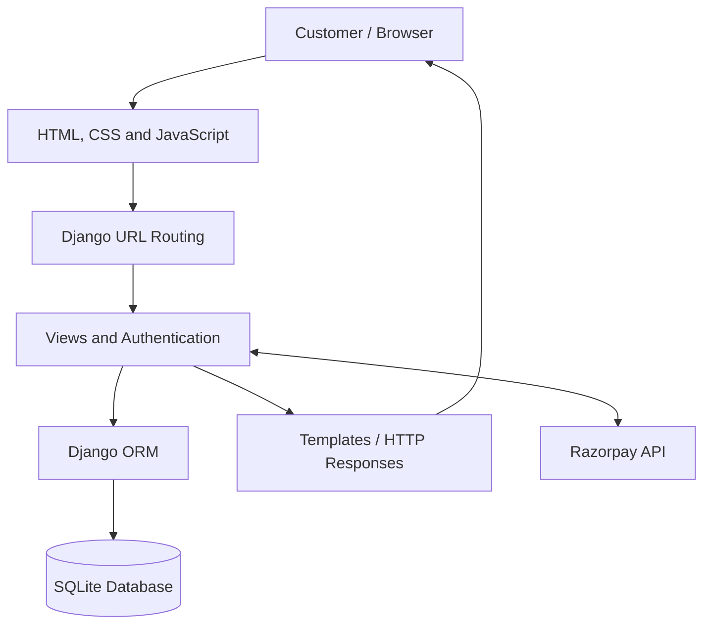
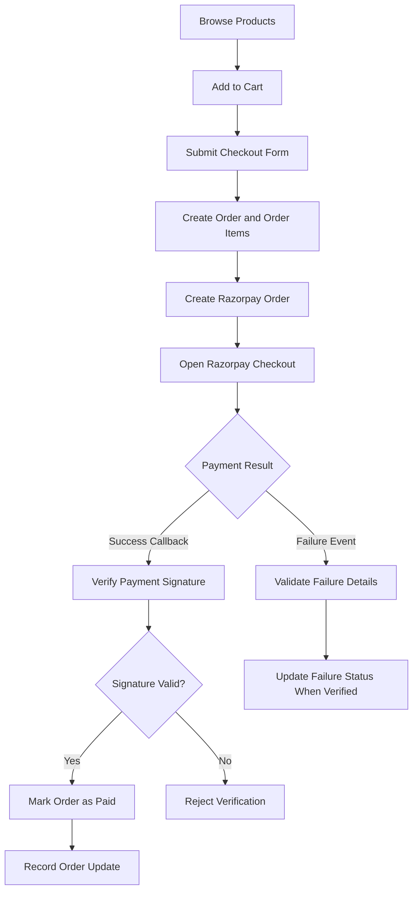
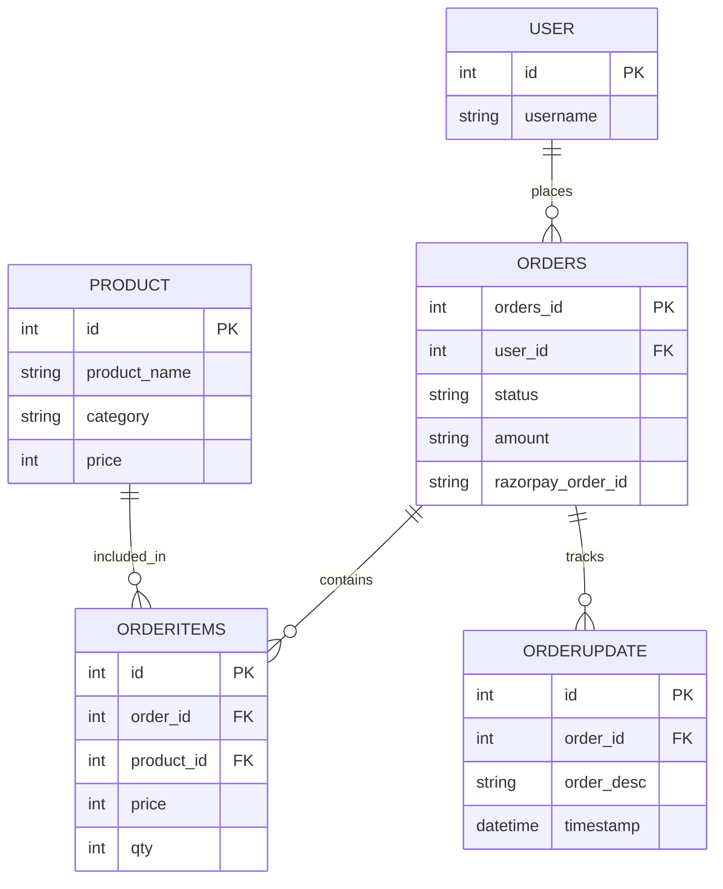

# Click & Cart 🛒
### Django-Based E-Commerce Web Application

Click & Cart is a full-stack e-commerce web application built with **Python and Django**. It provides user authentication, product browsing, shopping cart functionality, checkout, Razorpay payment integration, and user-specific order tracking.

The project focuses on building practical backend workflows, managing relational data, and implementing secure access to customer orders.

## 📌 Key Features

- **User Authentication:** Registration, login, and logout using Django authentication.
- **Product Catalog:** Browse products with descriptions, categories, prices, and images.
- **Shopping Cart:** Manage selected products before checkout.
- **Checkout Workflow:** Collect customer details and create orders with associated order items.
- **Payment Integration:** Integrate Razorpay Checkout and verify payment signatures on the server.
- **Order Tracking:** View order status updates and purchased product details.
- **User-Specific Order Access:** Restrict order lookup to the authenticated customer.
- **Contact Form:** Store customer inquiries.
- **Blog Module:** Organize blog content through a separate Django application.
- **Django Admin:** Manage application data through the administrative interface.

## 🛠️ Technology Stack

| Technology | Purpose |
|---|---|
| Python | Backend programming |
| Django | Web framework, authentication, routing, and ORM |
| SQLite | Relational database |
| HTML & CSS | Frontend structure and styling |
| JavaScript | Client-side interactions and payment checkout |
| Razorpay API | Online payment integration |
| Git & GitHub | Version control and collaboration |

## 🏗️ System Architecture

The application follows Django's Model–View–Template (MVT) architecture.



**Architecture overview:**

- **URLs:** Route incoming requests to the appropriate views.
- **Views:** Handle application logic, authentication checks, checkout, and order tracking.
- **Models:** Represent products, customers' orders, order items, and order updates.
- **Templates:** Render the user interface using Django's template engine.
- **Razorpay:** Handles payment checkout, with payment verification performed by the application server.

## 🔄 Checkout and Payment Flow



This flow illustrates the intended payment workflow. Production readiness also requires handling duplicate callbacks, payment reconciliation, and reliable server-to-server payment notifications.

## 🗄️ Database Design

The main models represent the following relationships:



**Design decisions:**

- Foreign keys connect orders to their customers and purchased products.
- Order items preserve the product price and quantity associated with an order.
- Order updates maintain a timestamped status history.
- The optional user relationship allows older orders to exist without an associated account.

## 🧠 Engineering Challenges and Solutions

### 1. Restricting access to customer orders

**Challenge:** Customers must not be able to view another customer's order by changing an order ID.

**Approach:** Filter orders using the authenticated Django user when retrieving order details.

```python
selected_order = orders.objects.filter(
    orders_id=order_id,
    user=request.user
).first()
```

This ensures the lookup returns only an order associated with the current user.

### 2. Simplifying order tracking

**Challenge:** Manually entering order identifiers makes order tracking less convenient.

**Approach:** Populate a dropdown with the logged-in customer's orders and use the selected order ID to retrieve its items and status updates.

### 3. Maintaining relationships between orders and products

**Challenge:** A single order may contain multiple products, quantities, and prices.

**Approach:** Use separate order and order-item models connected through foreign keys.

### 4. Integrating online payments

**Challenge:** The application must not trust a browser response alone when determining whether a payment succeeded.

**Approach:** Integrate Razorpay Checkout and verify the payment signature on the server before marking an order as paid.

### 5. Managing database schema changes

**Challenge:** Adding account associations and payment-related fields requires changes to the existing database schema.

**Approach:** Use Django migrations to version and apply model changes.

## 🔐 Security Considerations

- Use Django authentication and authorization.
- Validate ownership before returning order information.
- Keep secret keys and API credentials outside source control.
- Use CSRF protection for applicable form submissions.
- Verify payment signatures on the server.
- Validate payment failures and handle duplicate or delayed payment events.
- Use HTTPS and production-safe Django settings when deploying.

## ⚙️ Installation and Setup

### Prerequisites

- Python 3.13 or another version supported by the project's installed Django release
- pip
- Git

### 1. Clone the repository

```bash
git clone YOUR_GITHUB_REPOSITORY_URL
cd click-and-cart
```

If `manage.py` is inside a nested project directory, navigate into that directory before continuing.

### 2. Create a virtual environment

**Windows PowerShell**

```powershell
python -m venv venv
.\venv\Scripts\Activate.ps1
```

### 3. Install dependencies

If the repository includes `requirements.txt`:

```bash
pip install -r requirements.txt
```

Otherwise, install the project's dependencies based on the packages used in the application.

### 4. Configure environment variables

Configure Django's secret key and Razorpay credentials using environment variables. Ensure `settings.py` reads those variables.

Example configuration names:

```text
DJANGO_SECRET_KEY=your_secret_key
RAZORPAY_KEY_ID=your_razorpay_key_id
RAZORPAY_KEY_SECRET=your_razorpay_key_secret
```

Use Razorpay test credentials during development. Never commit real credentials to GitHub.

### 5. Apply migrations

```bash
python manage.py migrate
```

### 6. Create an administrator

```bash
python manage.py createsuperuser
```

### 7. Run the development server

```bash
python manage.py runserver
```

Visit `http://127.0.0.1:8000/` in your browser.

## 🚀 Future Enhancements

- Customer order history dashboard
- Product search, filtering, and sorting
- Wishlist and product reviews
- Inventory and stock management
- Automated tests for checkout and payment workflows
- Razorpay webhook integration and payment reconciliation
- Production deployment, logging, and monitoring

## 👨‍💻 Author

**Anurag Jat**

B.Tech — Computer Science and Engineering

- GitHub: YOUR_GITHUB_USERNAME
- LinkedIn: YOUR_LINKEDIN_PROFILE

---

*Developed to practice Django application development, relational database design, authentication, e-commerce workflows, and payment gateway integration.*
